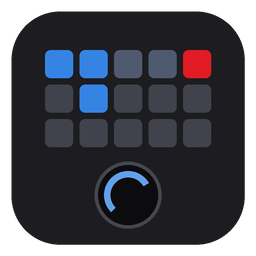
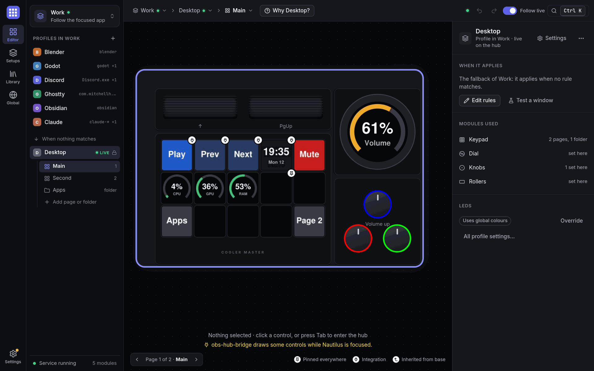
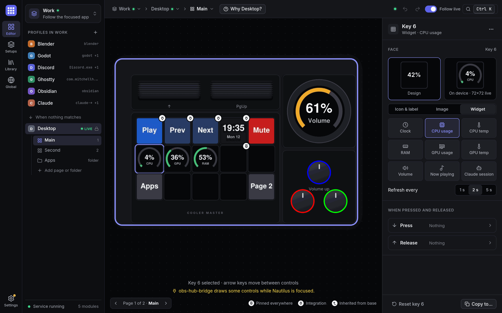
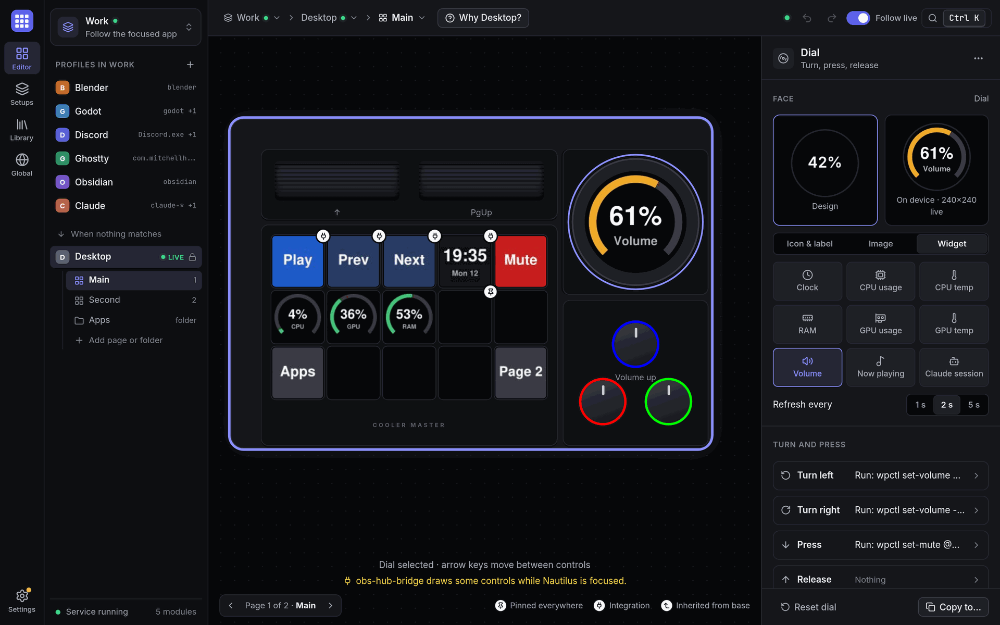
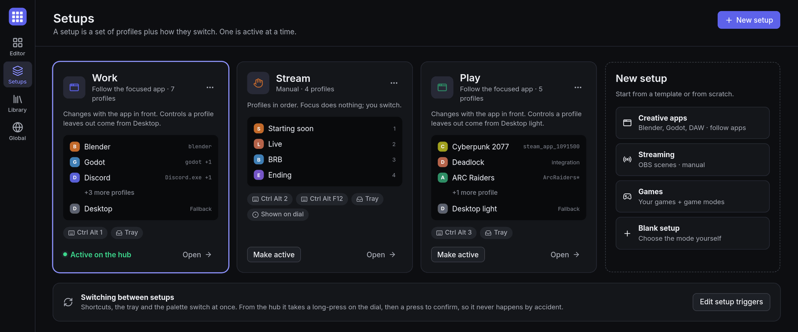
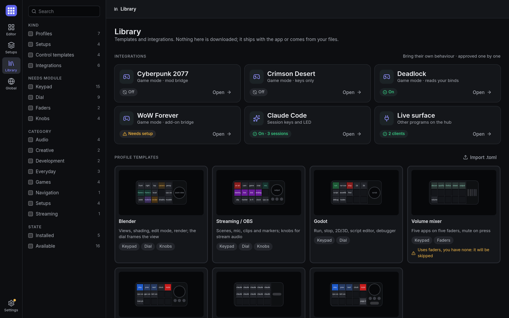
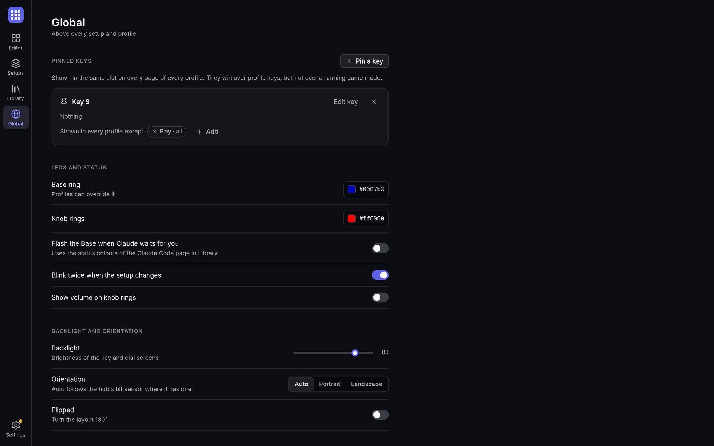
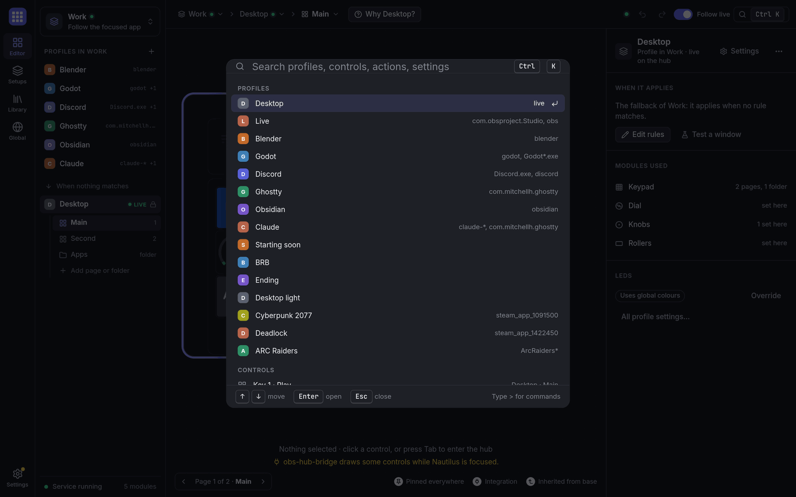
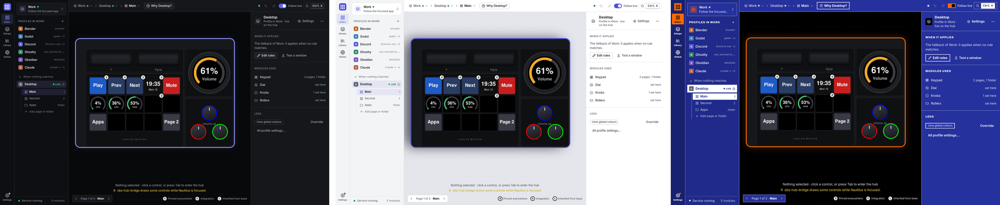

<p align="center">
  
</p>

<h1 align="center">OpenMasterHUB</h1>

<p align="center">
  <b>Your MasterHUB, without the vendor app.</b><br>
  Open-source driver, service and desktop app for the Cooler Master MasterHUB modular controller,
  on Linux and Windows.
</p>

<p align="center">
  <a href="https://github.com/hoxton314/openmasterhub/releases/latest"></a>
  <a href="https://aur.archlinux.org/packages/openmasterhub-bin"></a>
  <a href="https://github.com/hoxton314/openmasterhub/actions/workflows/ci.yml"></a>
  <a href="LICENSE"></a>
</p>

<p align="center">
  
</p>

## Why OpenMasterHUB

- **Every shipping module works:** Base, 15-key IPS keypad, 5 faders, 3 knobs, 2 rollers and the
  dial with its 240×240 screen, all verified on hardware.
- **What you see is your hub.** The editor draws your modules where they sit on your desk, turned
  the way you placed them, with what every screen shows right now. Click anything to change it.
- **Setups for every mood.** Let the hub follow the app in front, step through scenes by hand
  while you stream, or mix both and pin a profile for a while.
- **Live keys.** Clock, CPU/GPU load and temperature, RAM, volume and now playing with cover art,
  drawn right on the keys and the dial.
- **Make it yours.** Three built-in themes and your own as a small JSON file.
- **Plain text config, small and native.** One TOML file for your dotfiles, a Rust background
  service and a Tauri app. No Electron, no account, no cloud.

## A tour

### Click a control, edit it



Click a key to set its label, colours, icon (PNG, JPEG or animated GIF) or live widget, and what
it does on press, release and hold:

- **Keys** sends shortcuts and media keys (`ctrl+shift+t`, `playpause`, `f13`).
- **Volume** and **Mute** change the default output, another output, a microphone, one app
  (Discord, Spotify) or a group of apps (all your games), on Linux and Windows alike.
- **Command** runs anything: scripts, `playerctl`, `hyprctl`, `cmd` on Windows.
- **Page**, **Folder**, **Back**, **Profile**, **Setup** and **Pin** move around your own layouts,
  so 15 keys hold as many actions as you need.

Every edit reaches the hardware at once and can be undone (`Ctrl Z`). Badges on the canvas show
which keys are pinned on every profile, drawn by another program, or inherited from a base
profile, and **Why Desktop?** explains in one line why the hub shows what it shows.

### Dial, knobs, rollers and faders



The dial has its own round screen with any widget or image, actions for turning, pressing and a
long press. Each knob has a turn and a press action and its own ring colour, rollers scroll or
zoom, and faders set the volume or send their position (`{value}`) to a command. Five faders make
a mixer: master, Discord, Spotify, a "Games" group and the microphone.

### Setups: follow the app, switch by hand, or both



A setup is a set of profiles plus how they switch:

- **Follow** changes the profile with the app in front. Give each profile window classes (or
  `.exe` names on Windows) with `*` wildcards, pick them from the windows open right now, and
  try a window to see which profile it would get. Works on Hyprland and KDE Plasma (the KWin
  script loads by itself) and on Windows.
- **Manual** keeps the profiles in order and ignores focus: step through *Starting soon → Live →
  BRB → Ending* from the dial, a key or a shortcut.
- **Hybrid** follows the app until you **pin** a profile, and the pin lets go on a timeout, the
  next app or the same shortcut.

Profiles can inherit from a base profile, so a "Blender" profile only lists the keys it changes.
Switch setups from the tray, a global shortcut (X11 and Windows; on Wayland bind
`masterhubd ctl setup Stream` in your compositor), the command palette or a long press on the
dial. The Base LED blinks in the setup's colour and, if you opt in, a small toast says what
changed:

<p align="center">
  
</p>

### Library: start from a template



Templates for whole profiles (Blender, OBS streaming, Godot, a volume mixer), single controls
and setups, filtered by module, category and what you have installed. Import a `.toml` someone
shared, or turn on an integration.

### Global keys, LEDs and the hub itself



Pin a key to every profile (except the setups you exclude), set the Base and knob ring colours,
backlight and orientation, and choose what the Base light reports.

### Command palette



`Ctrl K` finds any profile, control, action or setting and jumps there, or switches the hub.

### Themes you can share



Dark, Light and Signal ship with the app. A theme is one JSON file of colours, type, radii and
motion that can inherit from a built-in one; drop yours in `~/.config/openmasterhub/themes/` and
it shows up in Settings. Format and schema: [`docs/THEMES.md`](docs/THEMES.md).

### Claude Code on the Base LED and keys

The Base light flashes when one of your Claude Code sessions needs an answer, turns green when
a session is ready for a new prompt and blue while they work. The Claude profile gives every
open session (in the Claude app or a terminal) its own key, with its name and a mascot on a
background in the colour of its status; press it to jump to that session. Sessions can be
sorted with the ones waiting for you first, and the left roller pages through more sessions
than keys. Setup: [`docs/CLAUDE_CODE.md`](docs/CLAUDE_CODE.md).

### Live surface for other programs

Other programs can take over keys, the dial, knobs, rollers, faders and LEDs through the
service's local socket: they draw their own key and dial images, get the inputs, dim the
screens and run config actions, while the config keeps working under them. Claims can follow
the focused app, and the editor shows who draws what. Protocol:
[`docs/LIVE_SURFACE.md`](docs/LIVE_SURFACE.md).

### AI agents over MCP (opt-in)

Let Claude or another AI agent set up your hub for you: "make an OBS profile with scene keys
and a mic mute on the dial" or "add a hybrid Stream setup". Turn on **Settings › AI agents ›
Run MCP server** and connect the agent with the command shown there (`claude mcp add --scope
user openmasterhub -- masterhubd mcp`). The agent reads the modules, the live state and every
profile, edits profiles, pages, keys, dial, knob, fader and roller actions and setups, and
switches or pins profiles. Every change is checked like the app's before it is saved. Tools and
safety: [`docs/MCP.md`](docs/MCP.md).

### Game modes (opt-in)

Cyberpunk 2077, Deadlock, WoW Forever and Crimson Desert get their own keys, dial readouts
and intro while they have focus (from Dawid Gorczyca's PULPIT). Every game is off until you
switch it on in the Library, which shows what it will install and extract before you approve.
Nothing from any game ships with OpenMasterHUB: the look is read from your own install. See
[`docs/GAME_MODES.md`](docs/GAME_MODES.md).

### First run

The app greets you with a short walk-through: it checks the service, USB access and focus
tracking, draws the modules it found where they sit, and helps you pick your first setup.

## Install

| Platform | Package |
| --- | --- |
| **Arch Linux** | `yay -S openmasterhub-bin` ([AUR](https://aur.archlinux.org/packages/openmasterhub-bin)) |
| **Windows** | `OpenMasterHUB_<version>_x64-setup.exe` from the [latest release](https://github.com/hoxton314/openmasterhub/releases/latest) |
| **Anything else** | build from source, below |

Quit the vendor MasterHUB app first, because the two fight over the modules.

### Arch Linux (AUR)

```sh
paru -S openmasterhub-bin        # or yay -S openmasterhub-bin
systemctl --user enable --now masterhubd
```

The package installs the udev rule (access for the logged-in user), the systemd user unit and
the app launcher entry.

### Windows

Run the installer. It installs for your user only (no admin rights), starts the service at login
and adds OpenMasterHUB to the Start menu. The installer is not code-signed yet, so SmartScreen
asks once (*More info → Run anyway*). On first run the service writes a starter config to
`%APPDATA%\openmasterhub\config.toml`, and the log goes to
`%LOCALAPPDATA%\openmasterhub\masterhubd.log`.

Volume uses Core Audio and now playing uses the Windows media sessions (Spotify, browsers and
most players). Windows has no temperature sensors a normal user can read, so `cpu_temp` (and
the GPU widgets without an NVIDIA driver) show values while
[LibreHardwareMonitor](https://github.com/LibreHardwareMonitor/LibreHardwareMonitor) runs.

### From source (Linux)

```sh
# Access to the modules for the logged-in user
sudo install -m644 udev/70-masterhub.rules /etc/udev/rules.d/
sudo udevadm control --reload && sudo udevadm trigger

# Build and install the binaries to ~/.cargo/bin
cargo install --path crates/masterhubd
(cd app && npm ci && npx tauri build --no-bundle) && install -m755 target/release/openmasterhub ~/.cargo/bin/

# Run the service at login (the unit expects /usr/bin; point it at ~/.cargo/bin)
mkdir -p ~/.config/systemd/user
sed "s|/usr/bin/|$HOME/.cargo/bin/|" dist/masterhubd.service > ~/.config/systemd/user/masterhubd.service
systemctl --user enable --now masterhubd

# App launcher entry
install -Dm644 dist/org.openmasterhub.OpenMasterHub.desktop ~/.local/share/applications/org.openmasterhub.OpenMasterHub.desktop
```

Virtual key presses use `/dev/uinput`, which the logged-in user can normally access. Volume
actions and widgets talk to PipeWire (`pipewire-pulse`) or PulseAudio directly, and GPU widgets
use NVML (NVIDIA) or sysfs (AMD).

**Tray and shortcuts.** The app lives in the tray (on Linux this needs `libayatana-appindicator`;
without it the window just quits on close). Global shortcuts work on X11 and Windows; on Wayland
bind `masterhubd ctl setup NAME|next|prev`, `masterhubd ctl profile NAME|next|prev` and
`masterhubd ctl pin` in your compositor. The switch toast is off by default
(`[app.feedback] toast = true`, or Settings › Feedback); on Wayland it needs `gtk-layer-shell` and
a compositor with `wlr-layer-shell` (Hyprland, Sway, KDE; not GNOME).

## Developing the app

```sh
cd app
npm install
npx tauri dev        # the app, talking to a running masterhubd
npm run dev          # just the UI in a browser at http://localhost:5174, with a sample hub
```

## Configure

Open **OpenMasterHUB**, click a key, knob, fader, roller or the dial, and edit it. Changes
apply to the hardware immediately. The configuration lives in
`~/.config/openmasterhub/config.toml` (Windows: `%APPDATA%\openmasterhub\config.toml`); see [`examples/config.toml`](examples/config.toml) for
every option. The service reloads the file when it is edited by hand.

## Components

| Crate | What it is |
|---|---|
| `masterhub-proto` | Wire protocol: command encoding and input decoding, no I/O |
| `masterhub-core` | Config model, Base slot layout, face/widget rendering, IPC protocol and client |
| `masterhubd` | Background service: drives the hardware over hidraw, profiles/pages/folders, live widgets, per-app profiles (Hyprland or KDE Plasma on Linux, focused program on Windows), local IPC for the app |
| `masterhub-games` | Opt-in game modes over the live surface ([`docs/GAME_MODES.md`](docs/GAME_MODES.md)); `masterhub-games-render` draws their faces |
| `app/` (`openmasterhub`) | Tauri desktop app (Svelte UI): live picture of your hub, click-to-configure editor, setups, library, themes |

Protocol documentation: [`docs/PROTOCOL.md`](docs/PROTOCOL.md) and `docs/protocol-*.md`.

## Notes

- After the vendor app (or anything else) switches the keypad/dial to hardware mode, they
  ignore software mode until the MasterHUB is unplugged and replugged. `masterhubd` never sends
  hardware mode and tells you in its log when a replug is needed.
- `tools/` contains the Python probe and usbmon scripts used while reverse-engineering.
- Releases and the AUR package are built by CI; see [`docs/RELEASING.md`](docs/RELEASING.md).
- What comes next: [`docs/ROADMAP.md`](docs/ROADMAP.md).
