<p align="center">
  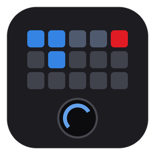
</p>

<h1 align="center">OpenMasterHUB</h1>

<p align="center">
  <b>Your MasterHUB, without the vendor app.</b><br>
  Open-source driver, service and desktop app for the Cooler Master MasterHUB modular controller,
  on Linux and Windows.
</p>

<p align="center">
  <a href="https://github.com/hoxton314/openmasterhub/releases/latest"></a>
  <a href="https://aur.archlinux.org/packages/openmasterhub-bin"></a>
  <a href="https://github.com/hoxton314/openmasterhub/actions/workflows/ci.yml"></a>
  <a href="LICENSE"></a>
</p>

<p align="center">
  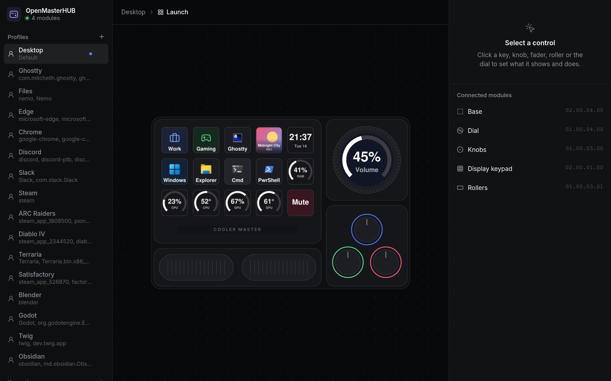
</p>

## Why OpenMasterHUB

- **Every shipping module works:** Base, 15-key IPS keypad, 5 faders, 3 knobs, 2 rollers and the
  dial with its 240×240 screen, all verified on hardware.
- **A profile per app.** The hub follows the focused window (Hyprland on Linux, the foreground
  program on Windows) and switches keys, dial and knobs to match.
- **Live keys.** Clock, CPU/GPU load and temperature, RAM, volume and now playing with cover art,
  drawn right on the keys and the dial.
- **Plain text config.** One TOML file you can keep in your dotfiles; the app and hand edits
  both apply to the hardware immediately.
- **Small and native.** A Rust background service plus a Tauri app; no Electron, no account,
  no cloud.

## Features

### Click a control, edit it

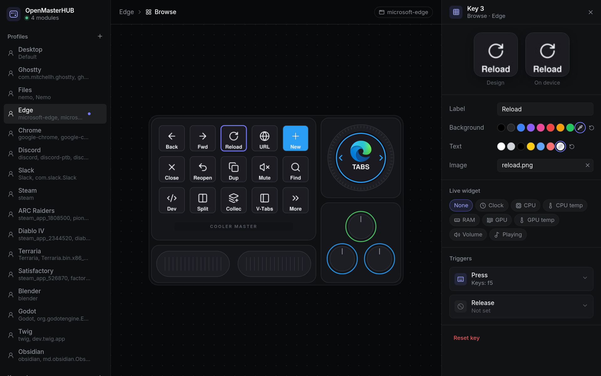

The app draws your hub as it sits on your desk, with what each screen is showing right now.
Click a key to set its label, colours, icon (PNG, JPEG or animated GIF) or live widget, and what
it does on press and release:

- **Keys** sends shortcuts and media keys (`ctrl+shift+t`, `playpause`, `f13`).
- **Command** runs anything: scripts, `wpctl`, `playerctl`, `hyprctl`.
- **Page**, **Folder**, **Back** and **Profile** move around your own layouts, so 15 keys can
  hold as many actions as you need.

### Dial, knobs, rollers and faders

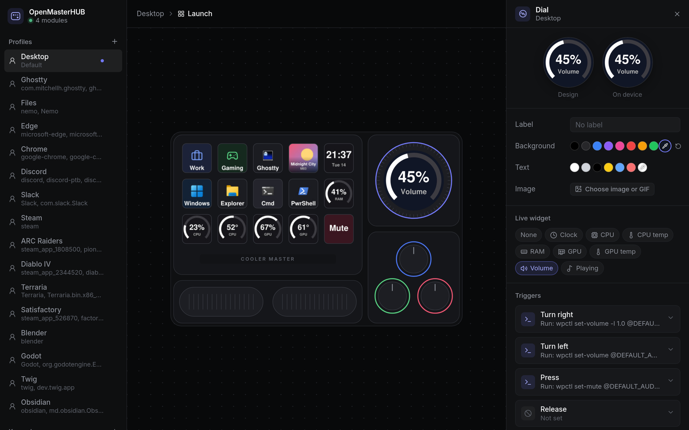

The dial has its own round screen with any widget or image, and actions for turning left, turning right and pressing.
Each knob has a turn and a press action and its own ring colour, rollers scroll or zoom, and
faders send their position (`{value}`) to a command.

### Profiles that follow your focus

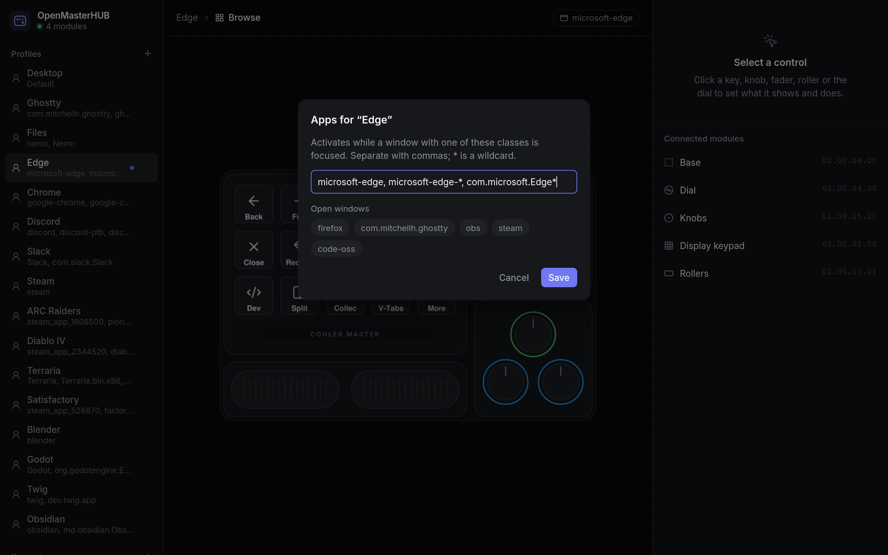

Give a profile the window classes (or `.exe` names on Windows) it is for, with `*` wildcards,
and pick from the windows that are open right now. The first profile is the fallback when no
listed app is focused.

<table>
  <tr>
    <td width="33%">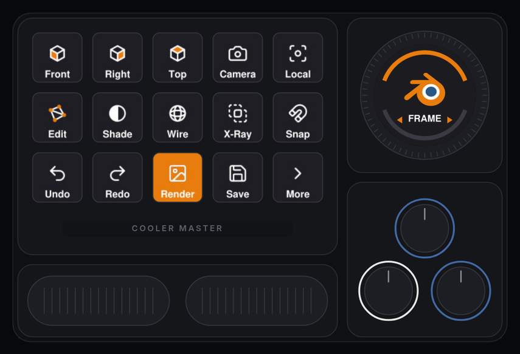</td>
    <td width="33%">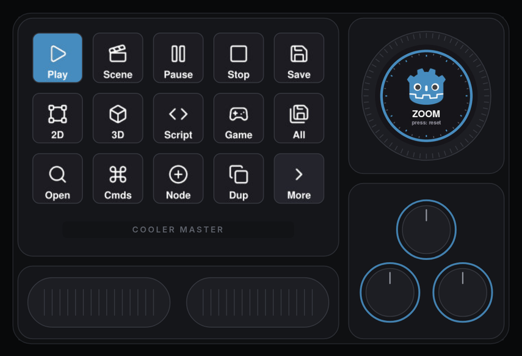</td>
    <td width="33%">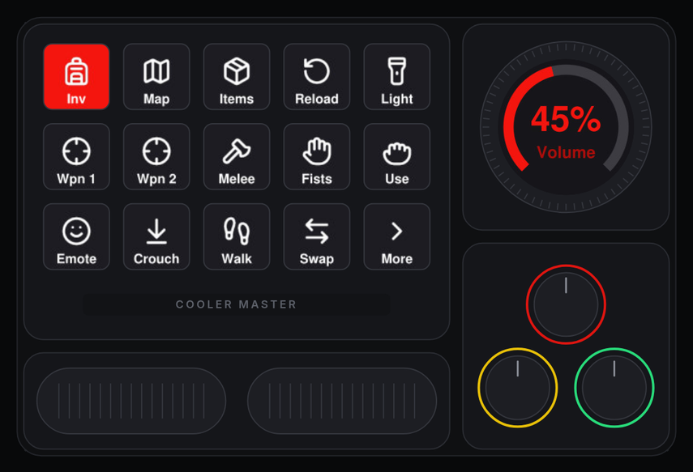</td>
  </tr>
  <tr>
    <td>Blender: views, shading, edit mode and render. The dial frames the view.</td>
    <td>Godot: run and stop, editor screens, and the dial zooms.</td>
    <td>ARC Raiders: inventory, weapons and movement keys.</td>
  </tr>
  <tr>
    <td>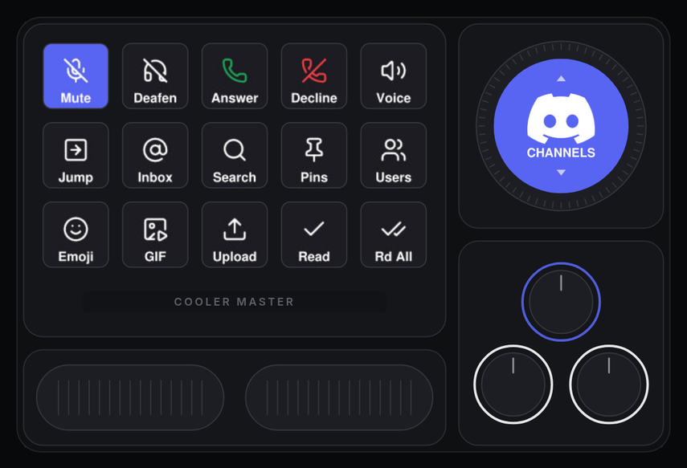</td>
    <td>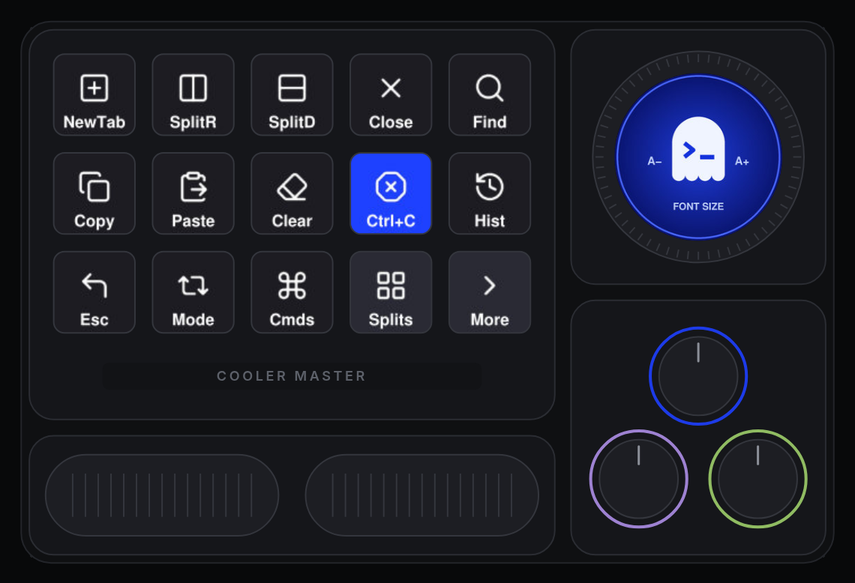</td>
    <td>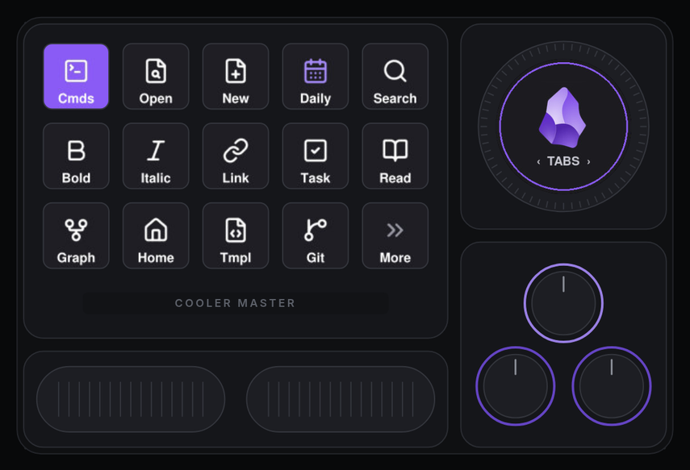</td>
  </tr>
  <tr>
    <td>Discord: mute, deafen and calls. The dial switches channels.</td>
    <td>Ghostty: tabs, splits and clipboard. The dial sets the font size.</td>
    <td>Obsidian: notes, formatting and the graph. The dial switches tabs.</td>
  </tr>
</table>

## Install

| Platform | Package |
| --- | --- |
| **Arch Linux** | `yay -S openmasterhub-bin` ([AUR](https://aur.archlinux.org/packages/openmasterhub-bin)) |
| **Windows** | `OpenMasterHUB_<version>_x64-setup.exe` from the [latest release](https://github.com/hoxton314/openmasterhub/releases/latest) |
| **Anything else** | build from source, below |

Quit the vendor MasterHUB app first, because the two fight over the modules.

### Arch Linux (AUR)

```sh
paru -S openmasterhub-bin        # or yay -S openmasterhub-bin
systemctl --user enable --now masterhubd
```

The package installs the udev rule (access for the logged-in user), the systemd user unit and
the app launcher entry.

### Windows

Run the installer. It installs for your user only (no admin rights), starts the service at login
and adds OpenMasterHUB to the Start menu. The installer is not code-signed yet, so SmartScreen
asks once (*More info → Run anyway*). The config lives in `%APPDATA%\openmasterhub\config.toml`.

### From source (Linux)

```sh
# Access to the modules for the logged-in user
sudo install -m644 udev/70-masterhub.rules /etc/udev/rules.d/
sudo udevadm control --reload && sudo udevadm trigger

# Build and install the binaries to ~/.cargo/bin
cargo install --path crates/masterhubd
(cd app && npm ci && npx tauri build --no-bundle) && install -m755 target/release/openmasterhub ~/.cargo/bin/

# Run the service at login (the unit expects /usr/bin; point it at ~/.cargo/bin)
mkdir -p ~/.config/systemd/user
sed "s|/usr/bin/|$HOME/.cargo/bin/|" dist/masterhubd.service > ~/.config/systemd/user/masterhubd.service
systemctl --user enable --now masterhubd

# App launcher entry
install -Dm644 dist/org.openmasterhub.OpenMasterHub.desktop ~/.local/share/applications/org.openmasterhub.OpenMasterHub.desktop
```

Virtual key presses use `/dev/uinput`, which the logged-in user can normally access. Volume
widgets use `wpctl` (PipeWire) and GPU widgets use NVML (NVIDIA) or sysfs (AMD).

## Developing the app

```sh
cd app
npm install
npx tauri dev        # the app, talking to a running masterhubd
npm run dev          # just the UI in a browser at http://localhost:5174, with a sample hub
```

## Configure

Open **OpenMasterHUB**, click a key, knob, fader, roller or the dial, and edit it. Changes
apply to the hardware immediately. The configuration lives in
`~/.config/openmasterhub/config.toml`; see [`examples/config.toml`](examples/config.toml) for
every option. The service reloads the file when it is edited by hand.

## Components

| Crate | What it is |
|---|---|
| `masterhub-proto` | Wire protocol: command encoding and input decoding, no I/O |
| `masterhub-core` | Config model, Base slot layout, face/widget rendering, IPC protocol and client |
| `masterhubd` | Background service: drives the hardware over hidraw, profiles/pages/folders, live widgets, per-app profiles (Hyprland on Linux, focused program on Windows), local IPC for the app |
| `app/` (`openmasterhub`) | Tauri desktop app (Svelte UI): live picture of your hub, click-to-configure editor |

Protocol documentation: [`docs/PROTOCOL.md`](docs/PROTOCOL.md) and `docs/protocol-*.md`.

## Notes

- After the vendor app (or anything else) switches the keypad/dial to hardware mode, they
  ignore software mode until the MasterHUB is unplugged and replugged. `masterhubd` never sends
  hardware mode and tells you in its log when a replug is needed.
- `tools/` contains the Python probe and usbmon scripts used while reverse-engineering.
- Releases and the AUR package are built by CI; see [`docs/RELEASING.md`](docs/RELEASING.md).
- What comes next: [`docs/ROADMAP.md`](docs/ROADMAP.md).
